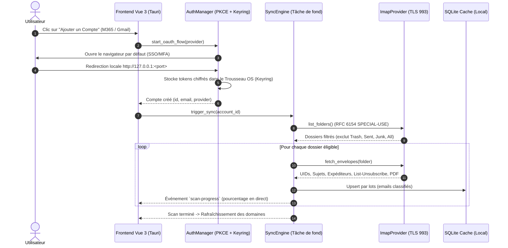

# Plan d'Implémentation : Finalisation du TDD (Réseau IMAP, OAuth2, Synchronisation & Ajout de Comptes)

Ce document détaille la stratégie d'implémentation pour finaliser l'ensemble des spécifications du document [`docs/TDD.md`](file:///Users/etienne/Developments/MailPurge/docs/TDD.md). Il permet de passer du mode actuel (socle métier validé avec jeu d'essai démo) à une application de production capable de se connecter aux boîtes réelles **Microsoft 365 Entreprise**, **Google Workspace / Gmail**, **iCloud** et **IMAP standard**.

---

## 1. Vue d'Ensemble & Objectifs



---

## 2. Décisions Techniques Requérant Validation (User Review)

> [!IMPORTANT]
> **Identifiants OAuth2 par défaut (Client ID) vs Saisie Utilisateur**  
> Pour Microsoft 365 et Google Workspace, l'application Desktop a besoin d'un `client_id` (application publique native avec redirect URI `http://127.0.0.1`).  
> *Recommandation :* Fournir un champ de configuration permettant d'utiliser soit un Client ID par défaut embarqué, soit le Client ID de l'entreprise si le tenant exige une *App Registration* interne approuvée par leur administrateur (comme documenté en section 2 du TDD).

> [!NOTE]
> **Stockage sécurisé des identifiants (Crate `keyring`)**  
> Les mots de passe d'application (iCloud, IMAP basique) ainsi que les *Refresh Tokens* OAuth2 ne sont **jamais stockés en clair dans SQLite**. Ils sont enregistrés directement dans le trousseau sécurisé de l'OS (Trousseau d'accès macOS Keychain, Windows Credential Manager).

---

## 3. Découpage en 4 Phases d'Implémentation

---

### Phase 1 : Adaptateur Réseau IMAP Réel (`ImapProvider`)
**Objectif :** Implémenter l'interface `MailProviderPort` pour dialoguer réellement avec les serveurs IMAP sur le port 993 via TLS (`rustls`).

* **Fichier :** `crates/mailpurge-core/src/imap_provider.rs`
* **Fonctionnalités :**
  1. Établissement de la session TLS via `imap::ClientBuilder` et `rustls`.
  2. Authentification `LOGIN` (mot de passe / app password) et `AUTHENTICATE XOAUTH2` via `XOAuth2Authenticator`.
  3. `list_folders` : commande `LIST "" "*"` et mapping des attributs RFC 6154 (`\Trash`, `\Sent`, `\Drafts`, `\Junk`, `\All`, `\NoSelect`).
  4. `fetch_envelopes` : commande `UID FETCH 1:* (UID RFC822.SIZE FLAGS ENVELOPE BODY.PEEK[HEADER.FIELDS (List-Unsubscribe Content-Type Subject From Date)])`.
  5. `move_to_trash` : commande `UID MOVE` (RFC 6851) avec repli automatique (`UID COPY` + `UID STORE +FLAGS (\Deleted)` + `UID EXPUNGE`).
  6. `empty_trash` : `STORE 1:* +FLAGS (\Deleted)` + `EXPUNGE`.

---

### Phase 2 : Authentification OAuth2 & Trousseau d'OS (`auth_manager`)
**Objectif :** Gérer l'authentification M365 et Gmail sans exposer de secrets, avec support natif du MFA entreprise.

* **Nouveau module :** `crates/mailpurge-core/src/auth.rs`
* **Dépendances à ajouter :** `keyring = "3.6"`
* **Fonctionnalités :**
  1. Mini-serveur local temporaire (socket TCP locale sur port aléatoire) pour recevoir le code de rappel OAuth2 (`/callback?code=...`).
  2. Génération du challenge PKCE (`code_verifier` / `code_challenge` S256).
  3. Échange du code contre `access_token` et `refresh_token`.
  4. Stockage et lecture via `keyring` sous le namespace `eu.gagnon.mailpurge`.
  5. Rafraîchissement automatique des tokens expirés lors des requêtes IMAP.

---

### Phase 3 : Moteur de Synchronisation Arrière-Plan (`sync_engine`)
**Objectif :** Orchestrer l'aspiration des dossiers, la classification instantanée et la persistance SQLite en arrière-plan sans bloquer l'UI.

* **Fichier :** `src-tauri/src/sync_engine.rs` & `src-tauri/src/lib.rs`
* **Fonctionnalités :**
  1. Tâche asynchrone lancée via la commande Tauri `sync_account(account_id)`.
  2. Émission d'événements `scan-progress` via `tauri::Emitter` :
     ```json
     { "account_id": 1, "folder": "INBOX", "scanned": 450, "total": 1200, "phase": "scanning" }
     ```
  3. Déduplication par `message_id` pour gérer les boîtes Gmail multi-libellés.
  4. Insertion par lots (chunks de 200 emails) dans `MailStorageRepository`.

---

### Phase 4 : Interface Utilisateur (Modal Connexion & Paramètres)
**Objectif :** Permettre à l'utilisateur d'ajouter un compte en 2 clics et d'ajuster le curseur d'ancienneté.

* **Fichiers :** `src/components/AddAccountModal.vue`, `src/App.vue`, `src/stores/mailStore.ts`
* **Fonctionnalités :**
  1. **Bouton « + Nouveau Compte »** dans la barre latérale gauche.
  2. **Modal de sélection du fournisseur :**
     - *Microsoft 365 (Entreprise / Personnel)* : déclenche l'ouverture du navigateur par défaut avec OAuth2 PKCE.
     - *Google Workspace / Gmail* : idem avec les scopes Google Mail IMAP.
     - *iCloud Mail* : formulaire Email + Mot de passe d'application sécurisé.
     - *IMAP Personnalisé* : hôte, port 993, SSL/TLS, identifiant et mot de passe.
  3. **Curseur d'ancienneté dynamique (30j, 45j, 60j, 90j) :**
     - Modifie la règle de calcul en base SQLite à la volée.
     - Met à jour instantanément le tableau des domaines et la jauge d'espace récupérable.
  4. **Indicateur de scan en direct :**
     - Affiche une barre animée sous le compte en cours de synchronisation avec le nombre d'emails traités.

---

## 4. Plan de Vérification & Tests

### Tests Automatisés
```bash
# Vérification de la suite de tests du noyau Rust
cargo test --workspace

# Vérification de l'absence de régression frontend
npm run build
```

### Tests d'Intégration Manuels
1. **Test Connexion Démo :** S'assurer que le mode démo existant continue de fonctionner sans régression.
2. **Test Connexion IMAP réelle (iCloud ou boîte de test) :** Valider la découverte des dossiers réels et l'apparition des domaines dans l'UI.
3. **Test OAuth2 Callback :** Vérifier que l'ouverture du navigateur et le retour sur `127.0.0.1` enregistrent bien le compte dans SQLite et le trousseau macOS/Windows.
4. **Test Déplacement Corbeille :** Vérifier qu'un déplacement en mode réel envoie bien les mails dans le dossier Corbeille distant.
